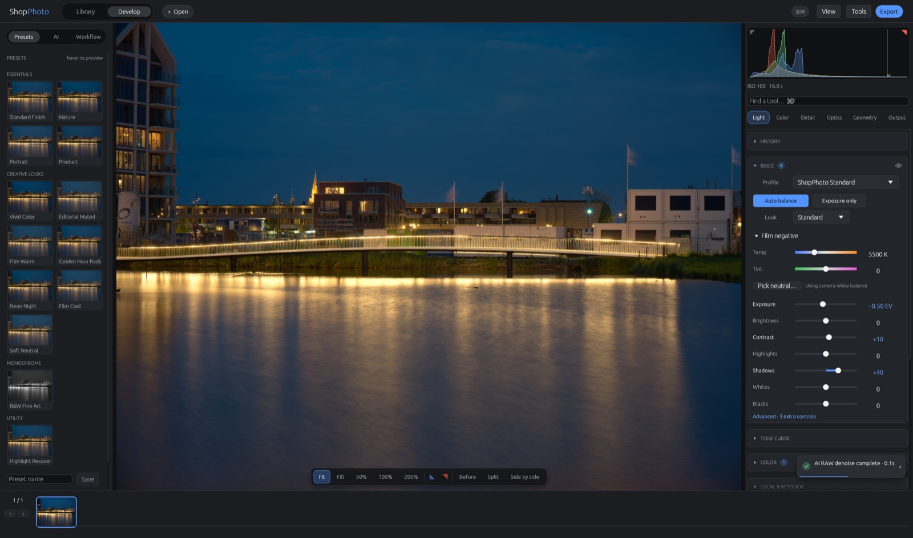
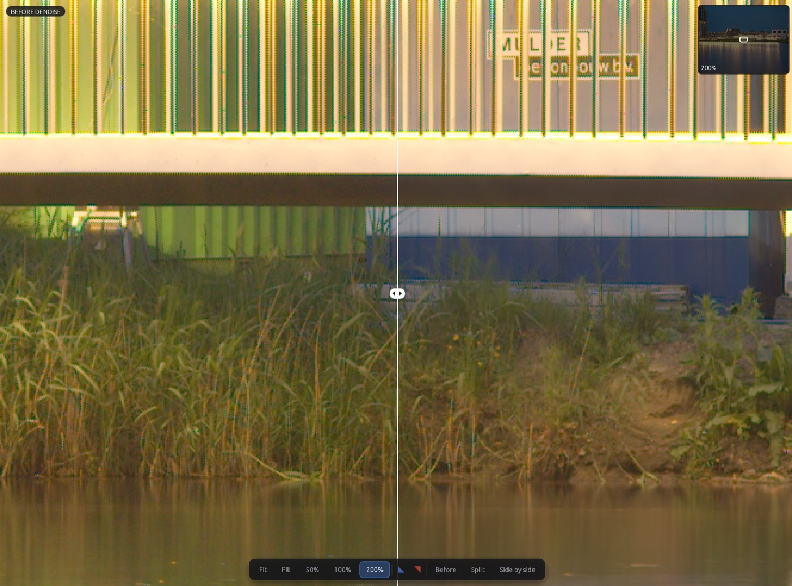
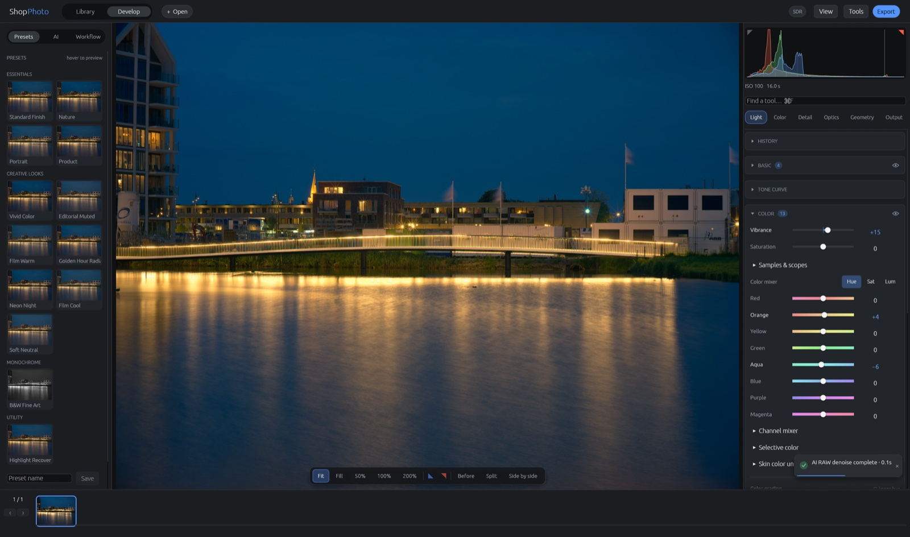
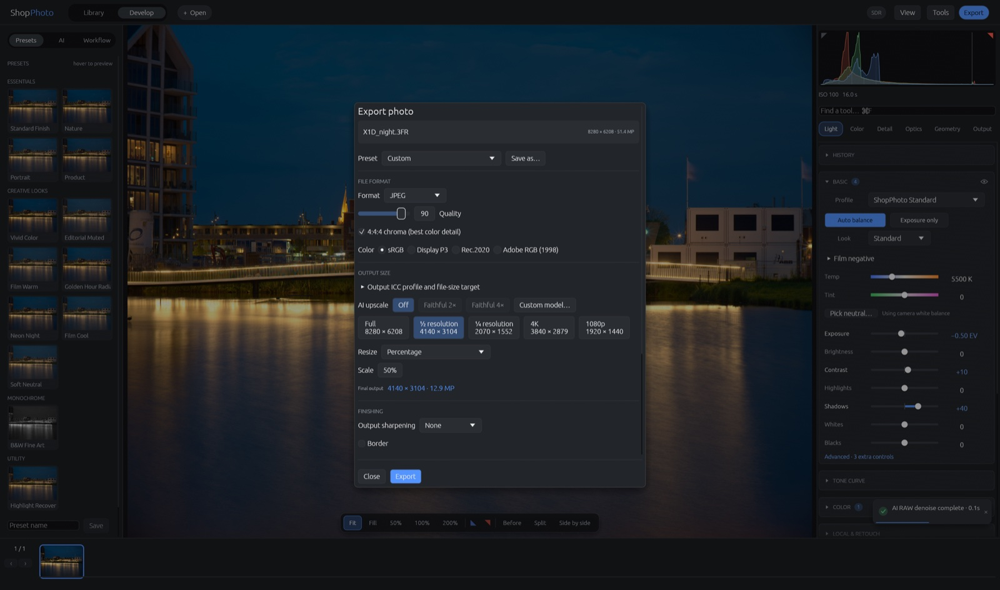

# ShopPhoto

A GPU-accelerated, non-destructive RAW photo editor in Rust, with first-class
Hasselblad medium-format support. macOS, Windows and Linux from one codebase, with a
scene-referred float pipeline from sensor to export.

Hasselblad `.3FR` and `.fff` are first-class — including the X2D II 100C —
alongside DNG and common Canon, Nikon, Sony, Fujifilm, Pentax,
Panasonic/Leica, Olympus/OM, Phase One and other camera RAW families.

## Screenshots

All screenshots show one 51 MP Hasselblad X1D II night exposure (16 s, ISO 100)
edited in ShopPhoto 0.5.0 on macOS.



**Develop.** One-click presets with live thumbnails, the scene-referred GPU
render, and Light, Color, Detail, Optics, Geometry and Output tools beside a
live histogram.



**ShopPhoto RAW Denoise.** The neural model runs on the Bayer sensor data
before demosaic. Split view at 200 % with the shadows lifted: untouched sensor
data on the left, the denoised result on the right.



**Color.** Vibrance and saturation, an eight-band color mixer in Oklab,
channel mixer, selective color, skin-tone uniformity and three-way color
grading.



**Export.** Presets, JPEG, TIFF, PNG, AVIF and Ultra HDR in sRGB, Display P3,
Rec.2020 or Adobe RGB, resize targets, optional AI upscaling and output
sharpening.

## What it does

The current development tree adds prioritized RAW navigation with bounded
preview caches, a shared command console/JSONL/MCP interface, optional
text-described masks and rendering reliability checks. See
[setup, examples and validation](docs/phase-lightcraft-lessons.md). The latest
personal macOS package adds native AI subject layers and faithful 2×/4× crop
upscaling; see [the 0.4.6 notes](docs/release-0.4.6.md). 0.4.7 adds guided,
previewed AI selections and halo-free layer clarity; see
[the 0.4.7 notes](docs/release-0.4.7.md). 0.4.8 adds HEIC/AVIF through macOS
ImageIO, clearer library and metadata states and the repository-audit fixes;
see [the 0.4.8 notes](docs/release-0.4.8.md). 0.4.9 adds Golden Hour Radiance
and Neon Night presets with HDR-aware highlight rolloff and consistent preset
previews after changing HDR mode; see [the 0.4.9 notes](docs/release-0.4.9.md). 0.5.0
adds ShopPhoto's own neural RAW denoise for every Bayer RAW, bundled in the
macOS app, and opens immediately while network shares are mounted; see [the 0.5.0 notes](docs/release-0.5.0.md). It retains the
Presets/AI/Workflow sidebar, faster exports, repeat AI selections, live zoomed
previews and saved Camera RAW denoise hardware choices from 0.4.4.

Version 0.4.3 retains interactive AI workers, caches image
encodings/depth/semantic predictions and uses uncompressed mask input to
reduce repeated inference and image-transfer work. See
[AI performance changes and benchmarks](docs/phase-ai-performance.md).

Version 0.3.1 is a GUI pass: before/after for every edit, a viewport toolbar
and navigator, clearer sliders and inspector cards, preset previews, named
history, a keyboard-first Library and actionable notifications — see
[the 0.3.1 notes](docs/release-0.3.1.md).

Version 0.3.0 adds AI local selections with learned boundary matting,
background Auto Finish batches and optional DRCT/HAT/SwinIR upscaling.
See [setup, workflow and limitations](docs/release-0.3.0.md). These enhancements
use a separate optional runtime.

- **RAW decoding** for 3FR / FFF / DNG / CR2 / CR3 / NEF / ARW / RAF / RW2 /
  ORF / PEF and other rawler-supported formats, with orientation, black/white levels,
  as-shot white balance and the camera color matrix taken from the file.
- **A fully GPU develop pipeline** (`wgpu` compute): demosaic → white balance
  and camera matrix → camera profile → noise reduction → tone and color →
  local contrast → sharpen → output transform. Every intermediate is
  `rgba16float` in scene-linear Rec.2020; nothing is clipped until output.
- **Camera color profiles** in three tiers: the embedded matrix, imported
  Adobe DCP profiles, and *Reference Match* — a fitter that learns a 3×3, a
  chroma-plane warp, a curve and a 33³ LUT from your own neutral 16-bit TIFF
  exports from Phocus or another trusted renderer, and reports holdout ΔE00.
- **Luma-invariant color rendering**: colour is corrected as a function of
  chromaticity alone, on a normalized-RGB plane, and recombined with the
  pixel's original luma — so a hue renders identically in shadow and
  highlight instead of drifting with exposure the way an RGB cube does.
- **Lens corrections**: per-photosite shading (vignetting) correction from
  `.splens` profiles, applied pre-demosaic so a colour cast toward the corners
  is corrected per CFA channel rather than averaged into a luminance falloff.
  Profiles interpolate between calibrated apertures by the shot's f-number and
  auto-match on the recorded lens, including per-focal-length maps for zooms.
  Grids come from your own flat-field captures. A separate selective Defringe
  stage automatically analyzes highlight edges for purple and green axial
  chromatic aberration, with independent manual strengths, radius, and edge
  protection; it works even when no calibrated lens profile is installed.
- **Noise control**: hot-pixel suppression and a pre-demosaic mosaic-domain
  bilateral, then non-local-means luminance and Oklab chroma reduction, with a
  1:1 loupe to judge it. Defaults are seeded from ISO. ShopPhoto RAW Denoise uses
  ShopPhoto's own neural model on Bayer sensor data; see
  [the model and runtime details](docs/raw-denoise.md).
- **Supersampling downscale**: average whole sensor quads — 100 MP → 25 MP,
  50 MP → 12.5 MP — for smaller files and about a stop of noise improvement.
  2×2 is exact Bayer superpixel; 3×3 and 4×4 box-average after demosaic.
- **Tone and color**: parametric and point curves per channel, 8-band HSL in
  Oklab, three-way color grading, a monochrome mixer, clarity/texture/dehaze,
  post-crop vignette, deterministic film grain, 11 one-click develop presets,
  and saveable user presets.
- **Conservative Auto Balance**: robust luminance percentiles coordinate
  exposure, endpoints and tonal regions while preserving low-key and high-key
  intent. Applying a creative preset keeps the scene-specific exposure,
  bounded midtone lift, and endpoints unless that recipe explicitly replaces
  an endpoint.
- **HDR**: float scRGB display output on macOS and Windows, PQ export, and Ultra HDR JPEG with a
  standards-based gain map so compatible phones and browsers can show the
  highlights while everything else sees an ordinary JPEG. A near-white,
  hue-preserving shoulder gives
  speculars pop before rolling them softly into the selected display limit.
- **Export**: JPEG, TIFF (8/16), PNG (8/16), AVIF, JPEG XL (16-bit lossy/lossless), Ultra HDR JPEG; sRGB /
  Display P3 / Rec.2020 with generated ICC profiles; long-edge, short-edge,
  percentage, exact and megapixel sizing; output sharpening; batch export that
  does not block editing.
- **Library**: a SQLite catalog with removable watched folders, background
  scanning, a virtualized grid, ratings and flags, captions, keywords, color
  labels, search, duplicate hashes, collections, and a thumbnail cache.
  Ratings and descriptive metadata optionally mirror to `.xmp` for
  Lightroom/Bridge/Phocus.
- **Fast network editing**: RAWs on SMB/NFS and other network mounts use a
  20 GB local LRU working cache. Edit settings are committed locally first
  and mirrored back to the share in the background.
- **Non-destructive throughout**: edits live in a `.spedit` JSON sidecar next
  to the original (with the local cache as the write-first copy for network
  files). Originals are never written to, and a corrupt sidecar is
  quarantined, never deleted.

Keyboard shortcuts: [`docs/shortcuts.md`](docs/shortcuts.md).
The visual research notebook for HDR, Auto Balance, lens correction, presets,
Phocus, and the Studio Console UI is
[`docs/research-2026-08-31/index.html`](docs/research-2026-08-31/index.html).

## Building

Requires a recent stable Rust (MSRV 1.92) and a GPU that `wgpu` supports.

```bash
cargo run --release -p sp-app
```

CI runs locally rather than on GitHub-hosted runners. One script runs the
committed-weights check, `cargo fmt --check`, clippy with `-D warnings`,
`cargo test --workspace` and the visual-regression screenshot on the current
machine. The workflows in `.github/workflows` now only start by hand, so
Windows and Linux builds and release packaging are no longer checked
automatically:

```bash
scripts/ci-local.sh                 # all checks except fuzzing
scripts/ci-local.sh --skip-visual   # without the GUI screenshot comparison
scripts/ci-local.sh --fuzz 300      # plus 5 minutes of RAW decoder fuzzing
```

The visual check compares with the committed 1600×952 reference on matching
displays; elsewhere it records a machine-specific baseline in `.ci-local/` on
the first run and compares against that afterwards.

GPU tests skip themselves cleanly when no adapter is available, so the suite
runs on headless machines.

Packaging (universal macOS `.app` and DMG, NSIS installer, AppImage/Flatpak)
lives in `scripts/` and `packaging/`. Signing and notarization activate only
when the environment supplies credentials; builds are reproducible without
them. The macOS DMG also carries the self-contained research notebook beside
the app, a one-click notebook opener, and an Applications shortcut.

Every macOS build bundles ShopPhoto's own neural RAW denoise model
(`rawdenoise-lab` r4_plain); see [`docs/raw-denoise.md`](docs/raw-denoise.md).
`scripts/bundle-personal-macos.sh` additionally packages native HEIC/AVIF
codecs and locally installed native enhancement models.

### Optional test and QA hooks

| Variable | Effect |
|---|---|
| `SP_TEST_RAWS=<dir>` | Runs the real-file decode/render/export harnesses against your own RAWs |
| `SP_PERF_STRICT=1` | Tightens `tests/perf_budget.rs` to development-machine timings |
| `SP_DUMP_DIR=<dir>` | Writes rendered proxies as PNGs for visual comparison |
| `SP_SCREENSHOT=<path>` | Captures the real window a few seconds after launch, then exits (needs `SHOPPHOTO_SDR=1`) |
| `SHOPPHOTO_SDR=1` | Forces the classic 8-bit surface instead of the macOS EDR float surface |
| `SHOPPHOTO_DENOISE_MODELS=<dir>` | Overrides the directory for the ShopPhoto RAW Denoise model |

`cargo bench -p sp-pipeline` reports open, render and export timings.

`shopphoto --hdr-check` prints the surface format, colorspace, panel
capability and a verdict, then exits — the canonical way to confirm a build
has working EDR.

## Layout

```
crates/sp-core       types, color math, edit state, camera profiles
crates/sp-raw        RAW decoding (rawler) → sp-core types
crates/sp-gpu        device, compute pipelines, texture and upload helpers
crates/sp-pipeline   the develop executor: proxy, 1:1 tiles, export renders
crates/sp-export     encoders, resampling, ICC, gain maps, presets
crates/sp-catalog    sidecars, XMP interop, SQLite catalog, thumbnails
crates/sp-app        the egui/eframe application
shaders/             every WGSL compute pass
docs/                per-phase implementation notes and deviations
vendor/              patched rawler and egui-wgpu (see vendor/rawler-patches)
```

[`BUILD.md`](BUILD.md) is the specification and the place to look before
changing architecture. [`PROGRESS.md`](PROGRESS.md) records what is actually
done, per session, including deviations. [`CONTRIBUTING.md`](CONTRIBUTING.md)
has the code standards.

## Status

Phases 0–9 and the 0.2.5 post-spec improvement plan are complete; the
remaining AI proposal is explicitly blocked on redistribution-safe model
weights rather than application work.
The live checklist—including partially implemented work and acceptance that
needs external hardware, data, or credentials—is
[`docs/review-improvements.html`](docs/review-improvements.html). Known format and
platform limits are listed in [`docs/file-formats.md`](docs/file-formats.md).

## License

Dual-licensed under [MIT](LICENSE-MIT) or [Apache 2.0](LICENSE-APACHE), at
your option. Vendored dependencies keep their own licenses.
